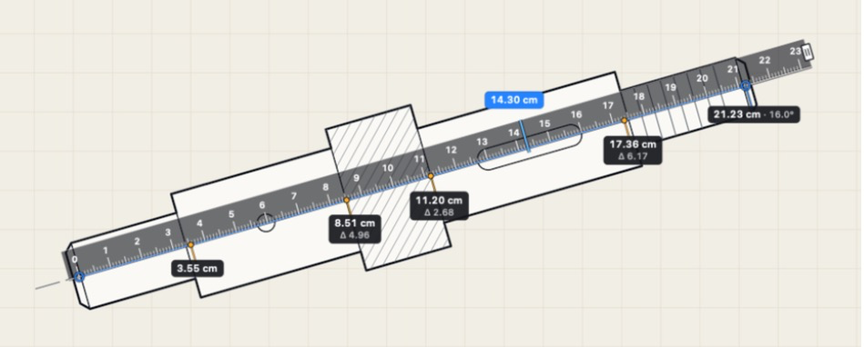
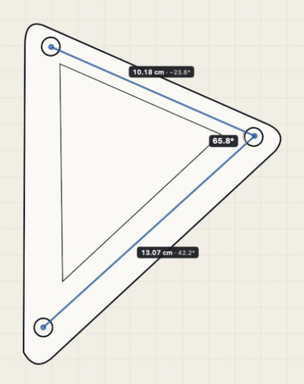

# AR Ruler

A macOS menu bar app for measuring real-world distances and angles on your screen. Click two points to lay a ruler exactly along what you're measuring, then read any position along it. There's no window in your way: without the modifier keys held, the overlay ignores the mouse completely.





*These are screen captures of the running app over a demo drawing. The points were placed by the Debug build's [virtual input](#virtual-input-debug-builds-only), not by hand.*

## Usage

Hold your modifier keys (**Control + Option** by default, set in Preferences) for everything below. Both must be down: one alone does nothing, so Control-click keeps working as right-click. Clicks without it go straight to the app underneath, and your current app keeps its focus either way.

| To | Do this |
| --- | --- |
| **Align** | Click two points. A ruler appears along them, with zero at the first click, ending on a whole cm or inch at least one unit past the second. The label on the blue line shows its length and tilt, like `7.49 cm · 89.9°`. |
| **Read** | Just move the mouse over the ruler, with or without the key. A marker shows the reading there. Away from the ruler there's no reading. |
| **Pin a reading** | Click on the ruler or within about 8 points of it. The pin shows its position and, under Δ, the gap from the next pin down the ruler. |
| **Measure an angle** | Click away from the ruler. It's replaced by plain lines, each labelled with its length and tilt, and the angle between them in bold by a small arc. A fourth point adds another line and angle, and the click after that starts a new measurement. |
| **Re-aim** | Drag either of the two points you clicked. |
| **Move** | Drag the ruler's body. |
| **Lengthen** | Drag the tab on the far end. The ruler changes length in whole units, down to the second point, without changing its zero or angle. |
| **Snap** | Hold **Shift** while placing a point or dragging one of the two points to snap to 0°, 45° or 90°. |
| **Clear** | Press **Esc**, or right-click with the key held. Also in the menu bar menu. |

While the key is held, the preview shows what a click would do: the marker turns amber when a click would pin, and a dashed line appears when it would add a point.

Pins stay with the spot they marked on screen, so their readings update if you then fine-tune the ruler. A pin left past the ruler's ends is hidden, and comes back if the ruler reaches it again. Switching to an angle measurement removes the ruler and its pins for good.

### Tilt and angle

A line's **tilt** is its slant from horizontal, from −90° to 90°, and it's the same whichever end you clicked first. Positive rises to the right on screen, and exactly vertical always reads 90°. It's the small, dim value beside a length. The **angle** between two lines is the bold value by the arc.

### Good to know

- **With Control alone as the modifier**, Control-click is taken over while measuring, which is why it's no longer the default.
- **VoiceOver** uses Control + Option as its own modifier. With VoiceOver on, choose another key in Preferences.
- **"On the ruler" means the body you can see**, plus about 8 points around it. A click past the end is an angle point, even in line with the ruler. Lengthen the ruler first to pin further along.
- **Angle measurements can't be fine-tuned.** Clear and click again to redo one.
- **One screen at a time.** Clicks on another screen are ignored until the measurement is cleared or has its 4 points.

## Menu bar app

AR Ruler lives only in the menu bar, with no Dock icon or Cmd-Tab entry. Its ruler icon's menu has Clear Measurement, calibration, Launch at Login, Preferences and Quit.

- **Launch at Login** is off until you turn it on. The checkmark shows what macOS has on record, including changes made in **System Settings > General > Login Items**. If macOS wants your approval there, the menu item says so and opens the page.
- **If the icon is hidden**, as macOS can do in a crowded menu bar, open AR Ruler again from Applications or Spotlight. That opens Preferences, and Cmd-Q quits from there.

Upgrading from a version with **Control** chosen moves you to Control + Option once. Option or Command are left as they were, and you can choose Control again in Preferences; it won't be changed back.

## Calibration

By default the scale comes from the physical size the display reports, or 72 points per inch if it reports none. Some displays report it wrongly. To correct it for a display:

1. Hold something of known length against the screen, such as a bank card (8.56 cm wide).
2. Hold your modifier keys and click its two ends to lay the ruler across it.
3. Choose **Calibrate This Display…** from the menu bar menu and enter its true length.

This is saved per display and keeps working if you change the display's scaled resolution or rotate it. **Reset Calibration** returns to the reported size. The menu shows the current scale and where it came from.

## Permissions

Nearly everything works with no permissions, including holding the keys, clicking and moving the mouse.

The exception is **Esc while another app is frontmost**. macOS only shares other apps' key presses with apps that have Accessibility access, so without it Esc does nothing there. Right-click with the keys held, and **Clear Measurement** in the menu, work either way.

To allow it, choose **Allow Esc to Clear in Other Apps…** in the menu, which only appears while it's missing, or enable AR Ruler in **System Settings > Privacy & Security > Accessibility**. AR Ruler only uses this to notice the Esc key. Because builds are ad-hoc signed, a rebuilt copy may need to be allowed again.

## Install from source

There's no prebuilt download, so you build it yourself. You need macOS 13 or later and Xcode 15 or later.

```bash
git clone <this repository's URL>
```

```bash
cd AR-Ruler
```

```bash
xcodebuild -project AR-Ruler.xcodeproj -scheme AR-Ruler -configuration Release -derivedDataPath build build
```

```bash
cp -R build/Build/Products/Release/AR-Ruler.app /Applications/
```

```bash
open /Applications/AR-Ruler.app
```

If `xcodebuild` complains that it needs Xcode rather than the Command Line Tools, put `DEVELOPER_DIR=/Applications/Xcode.app/Contents/Developer` in front of it. The ruler icon then appears in the menu bar.

## Building

You can also open `AR-Ruler.xcodeproj` in Xcode and run the AR-Ruler scheme. `project.yml` is the source of truth for the Xcode project, so after adding files, run `xcodegen generate`.

### Tests

Run the tests with Cmd+U. Geometry, ticks, click handling and calibration are plain Swift in `AR-Ruler/Core`, so the tests run without launching the app.

To look at the rendering, save it to PNGs over light, dark and busy backgrounds:

```bash
TEST_RUNNER_ARRULER_SNAPSHOT_DIR=/path/to/existing/folder xcodebuild -project AR-Ruler.xcodeproj -scheme AR-Ruler test
```

### Virtual input (Debug builds only)

Debug builds can be driven by a script, for testing and screenshots without physical keys. Scripted input goes through the same entry point as real keys and mouse (`OverlayInput`), so it runs the same logic and drawing.

```bash
build/Build/Products/Debug/AR-Ruler.app/Contents/MacOS/AR-Ruler --input-script scripts/virtual-input/demo-ruler.txt
```

To retake the README images, save `scripts/virtual-input/demo-scene.html` as a 16:10 image, open it full screen in Preview on a 1920x1080 display, and run `demo-ruler.txt` and `demo-angle.txt`. The scripts' points only line up with that layout.

The app stays running afterwards, with the result on screen. Rewriting the file runs it again, and each run's log goes to `<script>.log`. A script with any bad line doesn't run at all, and the log lists every problem. Real keys and mouse are ignored for that launch, so they can't disturb a capture, unless a script says `physical on`.

| Command | What it does |
| --- | --- |
| `hold` | Holds the keys set in Preferences. `hold control`, `hold control option` and so on hold specific ones instead, replacing what was held. |
| `release` | Lets go of the held keys. |
| `shift on`, `shift off` | Holds or lets go of Shift. |
| `move x y` | Moves the pointer. |
| `click x y` | Clicks. Without the keys held it passes through, as a real click would. |
| `drag x1 y1 x2 y2` | Drags in 8 steps. |
| `rightclick x y` | Right-clicks, which clears if the keys are held. |
| `esc`, `clear` | Clears the measurement. |
| `wait s` | Waits this many seconds. |
| `physical on`, `physical off` | Turns real keys and mouse on or off. |

Points are in screen points from the top-left of the main display, the same as a screenshot, and can be written `x y` or `x,y`. `#` starts a comment.

**What this does and doesn't prove:** it proves the app's logic and drawing. It doesn't prove that macOS delivers real key and mouse events to the app, so a person holding the keys and clicking is still the only test of that. It also creates no system events, and needs no permission or entitlement.

**It isn't in Release builds.** All of it, including reading the argument, is compiled only for Debug. To check, run `scripts/check-release-has-no-virtual-input.sh`, which builds both configurations and searches the binaries.

## Known limits

- **Only tested on macOS 27.** The deployment target is macOS 13, but it hasn't been run on anything older.
- **No notarized download.** Builds are ad-hoc signed, so for now you build from source.
- **Launch at Login hasn't been switched on or off in testing.** The menu item's logic is unit tested, and it has been seen showing the off state.
- **Multiple displays haven't been tested hands-on.** That includes "Displays have separate Spaces" and displays being connected or removed. The app uses one overlay per screen, but only a single display was available.
- **Holding Control + Option and clicking hasn't had a complete real-world test.** Detecting the held keys and handling the clicks were each tested with real events, but not yet together in this build. Holding a single key and clicking was tried by hand on an earlier build.
- **Shift-snapping and calibration accuracy** are covered by unit tests and a made-up length, but haven't been checked in real use against a real object.

## License

MIT. See [LICENSE](LICENSE).
